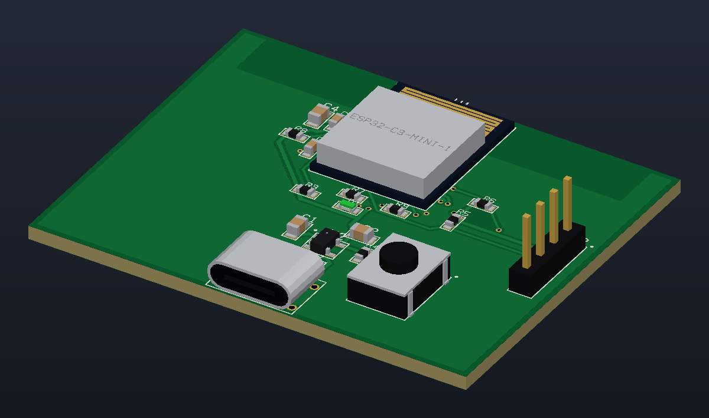
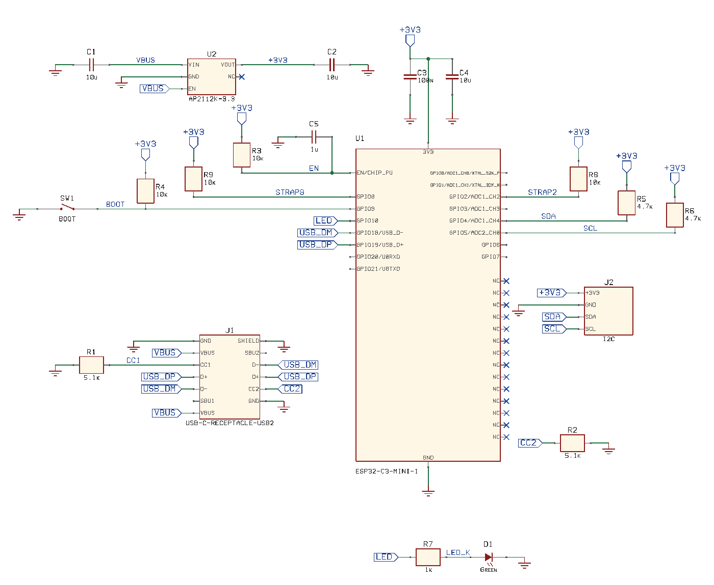
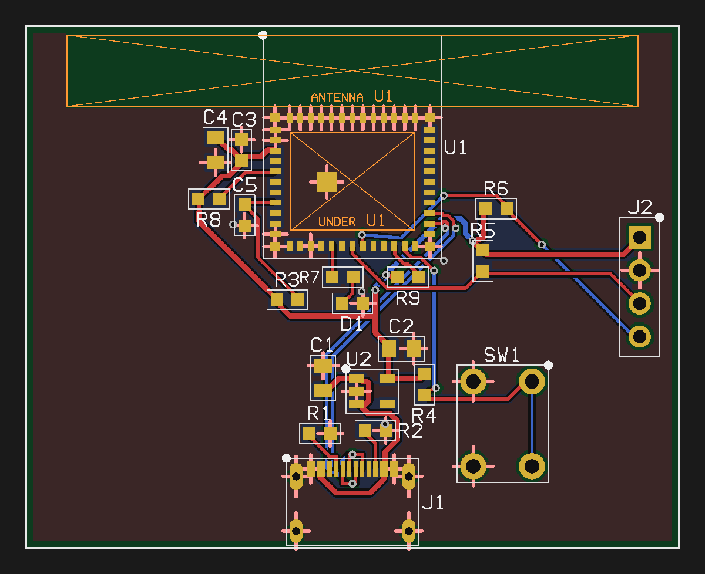
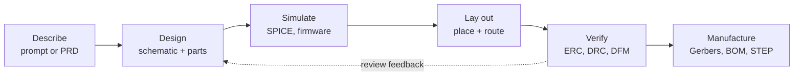

<div align="center">

<h1>SiEDA</h1>

<p><b>AI-native electronic design automation for macOS</b></p>

<p>Describe a product in plain language. SiEDA turns it into a verified schematic, a simulated circuit,<br>
a routed board, a 3D assembly and fabrication-ready files, and every step stays yours to edit.</p>

<p>


</p>

<p>
<a href="#see-it-in-action"><b>Gallery</b></a> &nbsp;·&nbsp;
<a href="#how-it-works"><b>How it works</b></a> &nbsp;·&nbsp;
<a href="#features"><b>Features</b></a> &nbsp;·&nbsp;
<a href="#use-sieda-from-any-ai"><b>MCP</b></a> &nbsp;·&nbsp;
<a href="#quick-start"><b>Quick start</b></a> &nbsp;·&nbsp;
<a href="docs/README.md"><b>Documentation</b></a> &nbsp;·&nbsp;
<a href="docs/FEATURES.md"><b>Full feature list</b></a>
</p>



<sub>An ESP32-C3 board taken from netlist to routed, DRC-clean copper by an AI agent through SiEDA's MCP server.</sub>

</div>

---

## At a glance

<table>
<tr>
<td align="center" width="25%"><h3>159</h3>MCP tools any AI client can call</td>
<td align="center" width="25%"><h3>1,675</h3>catalog parts with real pinouts and footprints</td>
<td align="center" width="25%"><h3>465</h3>core test suites, 1.2 million checks</td>
<td align="center" width="25%"><h3>20</h3>interface languages</td>
</tr>
</table>

## See it in action

One design, from the first wire to the finished board. Every picture below was drawn by SiEDA itself.

<table>
<tr>
<td width="33%" valign="top"><a href="docs/images/schematic.png"></a></td>
<td width="33%" valign="top"><a href="docs/images/pcb.png"></a></td>
<td width="33%" valign="top"><a href="docs/images/board-3d.png"></a></td>
</tr>
<tr>
<td valign="top"><b>1 · Schematic</b><br>One <code>schematic_build</code> call lays out the parts: pull-ups stand by their pins, wires are straight and decoupling caps share a rail.</td>
<td valign="top"><b>2 · Board</b><br>Auto Place keeps the antenna at the edge with its keep-out. The autorouter pours ground and routes the USB pair coupled. DRC passes.</td>
<td valign="top"><b>3 · 3D and fabrication</b><br>Bodies shaped like the real parts, then Gerbers, drills, IPC-2581, ODB++, STEP and a full fabrication package.</td>
</tr>
</table>

## How it works



A team of AI agents runs the pipeline: Requirements Analyst, Circuit Architect, Plan Compiler, Verification,
Design Reviewer and PCB Layout. Claude is the default; OpenAI, Gemini, OpenRouter, Ollama, SiEDA's own on-device
model, or no AI at all work too. Every result lands in the same editable schematic and board, so you can take over
at any step.

## Features

<table>
<tr>
<td width="33%" valign="top">

### Schematic capture
Sheets and hierarchy, repeated channels, buses, multi-unit parts, variants, find and replace, and a PDF with
embedded fonts. ERC and design review run as you go.

[Schematic guide →](docs/SCHEMATIC.md)

</td>
<td width="33%" valign="top">

### Simulation
A built-in MNA engine with DC, AC, transient, noise and temperature sweeps. Import SPICE models, or run real firmware
on the microcontroller in the circuit.

[Simulation guide →](docs/SIMULATION.md)

</td>
<td width="33%" valign="top">

### PCB layout
Push-and-shove routing, arcs, teardrops, differential pairs, length tuning, copper pours, keep-outs, cutouts and
multi-layer stack-ups with blind, buried and micro vias.

[Interactive routing →](docs/INTERACTIVE_ROUTING.md)

</td>
</tr>
<tr>
<td valign="top">

### Autorouter
Classic and corridor routers, coupled pairs, via minimisation, length-aware tuning and shape-based completion.
The same copper on any thread count.

[Routing guide →](docs/ROUTING.md)

</td>
<td valign="top">

### Signal and power integrity
A 2D field solver for impedance and loss, controlled-impedance stack-ups, PDN cavity model, IR drop and decap
planning.

[SI / PI guide →](docs/SIGNAL_POWER_INTEGRITY.md)

</td>
<td valign="top">

### Memory design
SDRAM and DDR design segments with DQS-to-lane and P-to-N skew checks, tuned to the controller's own layout guide.

[Memory guide →](docs/MEMORY_DESIGN.md)

</td>
</tr>
<tr>
<td valign="top">

### Libraries
1,675 catalog parts, footprint and symbol editors with land-pattern checks, and KiCad, Eagle and Altium library
import.

[Footprint Editor →](docs/FOOTPRINT_EDITOR.md) · [Symbol Editor →](docs/SYMBOL_EDITOR.md)

</td>
<td valign="top">

### Manufacturing
Gerber X2, Excellon, IPC-2581C, ODB++, manufacturer DFM / DFA rule packs, production panels, a fabrication drawing
and an interactive HTML BOM.

[Full feature list →](docs/FEATURES.md)

</td>
<td valign="top">

### Mechanical CAD
STEP AP214 out and in, IDF 3.0 and IDX (EDMD) round trips with the mechanical engineer, and 3D clearance checks
against the enclosure.

[MCAD guide →](docs/MCAD.md)

</td>
</tr>
<tr>
<td valign="top">

### AI back-ends
Cloud models, a built-in GGUF engine that runs Llama, Mistral and Qwen on your Mac, and SiEDA's own circuit model.

[AI guide →](docs/AI.md)

</td>
<td valign="top">

### Team work
Version compare, Git diff and merge drivers, variant matrix, review comments pinned to parts, and live co-editing
of a shared file.

[Team guide →](docs/TEAM.md)

</td>
<td valign="top">

### Suppliers
Live part search and BOM pricing from Nexar, DigiKey and Mouser, with price breaks and an offline cache.

[Suppliers guide →](docs/SUPPLIERS.md)

</td>
</tr>
</table>

## Use SiEDA from any AI

`sieda-mcp` is a [Model Context Protocol](https://modelcontextprotocol.io) server. Claude Desktop, Claude Code, Cursor,
VS Code, ChatGPT desktop or a local LLM can capture schematics, search the catalog, simulate, place and route boards,
run ERC / DRC, look at rendered pictures and write Gerbers. File access stays inside one folder, and `--read-only`
lets the AI look without changing anything.

```bash
cmake -S . -B build -DCMAKE_BUILD_TYPE=Release && cmake --build build -j --target sieda-mcp
claude mcp add sieda -- "$PWD/build/sieda-mcp" --root ~/Designs
```

In **live app mode** the AI works on the design open in the SiEDA window: you watch the canvas change, and each AI
edit is one Undo step. It listens on `127.0.0.1` only, needs a token and is off by default.

[MCP guide and tool reference →](docs/MCP.md)

## Quick start

```bash
git clone https://github.com/srinivasan-fh/si-eda.git
cd si-eda
./run.sh            # macOS: builds and launches SiEDA.app · Linux: builds the core and runs the demo
```

| Command | What it does |
|---|---|
| `./run.sh app` | Build the macOS app and launch it |
| `./run.sh test` | Core unit tests, plus the Xcode tests on macOS |
| `./run.sh demo [dir]` | Headless pipeline on the demo design: fabrication files and a verification report |
| `./run.sh cli design.siedaproj [dir]` | Verify a saved project and write its fabrication package |

The app needs macOS 14+ and Xcode 16+. The C++ core builds anywhere with CMake 3.20+ and a C++17 compiler.
Set-up details, keyboard shortcuts and every menu are in the [full feature list](docs/FEATURES.md#getting-started).

## Documentation

| | |
|---|---|
| **[Documentation hub](docs/README.md)** | Every guide, grouped by task |
| **[Full feature list](docs/FEATURES.md)** | Everything SiEDA does, with menus and shortcuts |
| **[Moving from KiCad, Altium or Eagle](docs/MIGRATING.md)** | Bring your libraries and designs across |
| **[Architecture](docs/ARCHITECTURE.md)** | The SwiftUI app, the C ABI and the C++ engine |
| **[File format](docs/FILE_FORMAT.md)** | The `.siedaproj` project file |
| **[Security](SECURITY.md)** | How to report a vulnerability |

## Repository layout

```
Core/        C++17 engine: schematic, simulator, PCB, autorouter, DRC, 3D, exports (no dependencies)
  cli/       sieda-cli: headless ERC → simulation → place & route → DRC → fabrication files
  mcp/       sieda-mcp: the Model Context Protocol server
SiEDA/       the macOS SwiftUI app
SiEDATests/  XCTest suite
docs/        guides (start at docs/README.md)
```

## License

Proprietary. All rights reserved.
