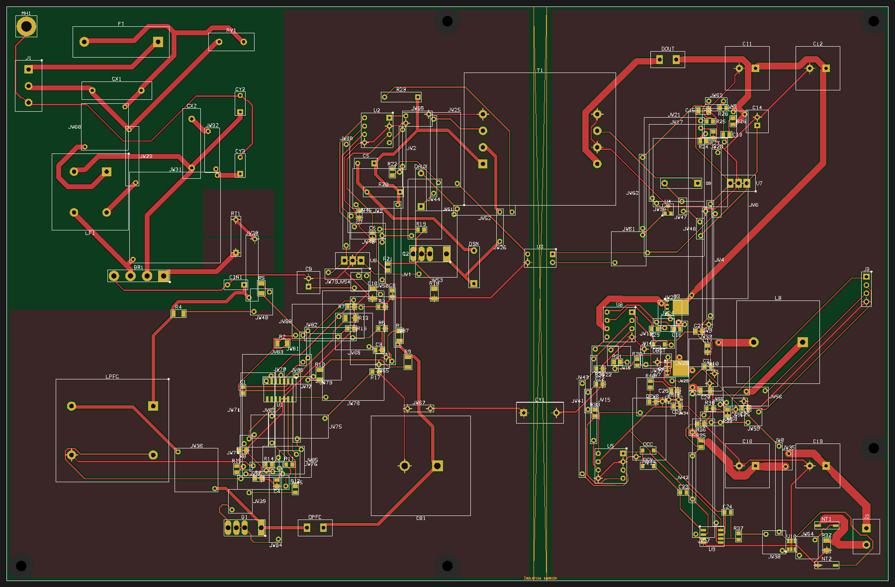
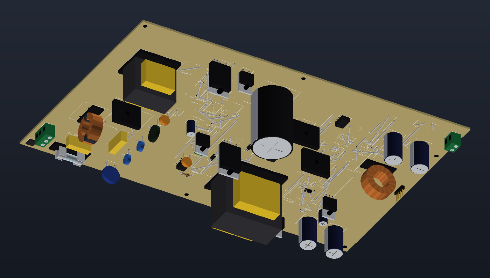

# SMPS: 230 VAC to 5–48 V DC, 1–5 A (CC / CV), single-sided

The [two-layer bench supply](../smps-230vac-5-48v) laid out again on a single-sided board: one copper layer, every
through-hole part on the component side, the small SMD parts on the copper side, and 88 wire links (JW1 … JW88)
where the copper alone cannot cross. Same circuit, same parts, same net classes; it is a built-in example too:
**File → New from Example → Production Boards** (macOS), **File → New from Example** (SiEDA Studio), or MCP
`project_load_example` with `{"id": "smps_230vac_1layer"}`.

## How it was made

1. The two-layer project, with the parts spread out a little (270 × 176 mm) so one layer has room.
2. Every through-hole part flipped to the bottom, the component side (`pcb_place_footprint` `bottom: true`).
3. Routed as a two-layer board whose bottom stands for the wire links: route-time keep-outs keep the bottom copper
   off the part bodies and the through-hole pads, and the vias off the SMD parts.
4. `pcb_add_jumpers` `fromBottom: true` turns each piece of bottom copper into straight wire links between its
   vias (a lead hole gets a spare hole beside it, joined by a short stub), removes the vias and leaves one copper layer.
5. The few connections left round the PFC controller (U1) re-routed by hand-picked rip-ups and part nudges, then
   ground pours on the copper layer (PGND primary, SGND secondary) and small pours on RT1's leads to spread its heat.

The wire links are real parts: on the BOM (0.6 mm tinned copper wire, or insulated where one crosses a part body),
in the pick-and-place, and on a schematic sheet of their own (sheet 7, "Wire links"), each pin labelled with its net.

112 parts + 88 wire links, 73 nets, 1 copper layer, 270 × 176 mm, IPC-2221 Class 3 with the power-electronics profile.

## Results

| Check | Result |
|---|---|
| Design verification ([verification.md](verification.md)) | **PASS**: 0 errors, 0 warnings (DC simulation skipped: no source or ground symbol on a connector-fed board) |
| DRC | Clean: every connection routed, no violation, net-class clearances kept (mains 2.5 mm, HV 2 mm) |
| Thermal ([thermal.json](thermal.json), [thermal.png](thermal.png)) | Same load and cooling as the two-layer board (40 °C ambient, forced air, ≈ 25 W of losses, TO-220 / GBU parts on clip-on heatsinks). Hottest board spot 100 °C |

One thermal finding is expected and accepted: R20, the 2 W snubber resistor, at ≈ 131 °C surface (rated 155 °C).
RT1 runs at ≈ 121 °C, Q3 (the buck's high-side MOSFET, cooled only through one layer of copper) at ≈ 102 °C junction;
with one copper layer the semiconductors run 10–20 °C warmer than on the two-layer board.

## Files

| File | Contents |
|---|---|
| [smps_230vac_1layer.siedaproj](smps_230vac_1layer.siedaproj) | The project: schematic, single-sided board, wire links, net classes, rooms, pours |
| [schematic.pdf](schematic.pdf), [schematic_1.png](schematic_1.png) … [schematic_7.png](schematic_7.png) | Schematic: the six stages and the wire links |
| [pcb.png](pcb.png), [3d.png](3d.png), [3d_copper.png](3d_copper.png) | Board render; 3D from the component side and from the copper side |
| [bom.csv](bom.csv) | Bill of materials, wire links included |
| [fabrication/](fabrication/) | Gerbers and drill (`smps_230vac_1layer-gerbers.zip`: one copper layer), fabrication drawing PDF, fab notes, assembly files, mechanical files, net lengths, SPICE netlist, bring-up checklist |

## Before you build it

This is a reference design, not a certified product. Mains voltages are lethal: build and test it only with an
isolation transformer, a current-limited source and the safety knowledge to do so. Fit the wire links before the
other through-hole parts (several run under them), check every custom footprint against the parts you buy, and have
the creepage / clearance and the isolation barrier reviewed against IEC 62368-1 before use.
