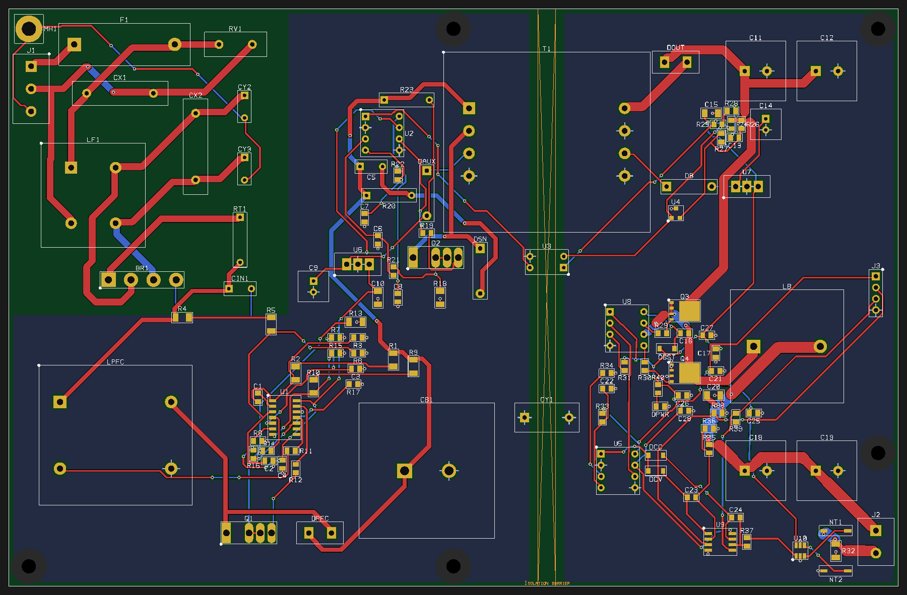

# SMPS: 230 VAC to 5–48 V DC, 1–5 A (CC / CV)

A bench power supply designed end to end in SiEDA through its MCP tools: schematic, placement, routing, checks and
the full production package. It is also a built-in example: **File → New from Example → Production Boards** (macOS),
**File → New from Example** (SiEDA Studio), or MCP `project_load_example` with `{"id": "smps_230vac"}`.

## The design

| Stage | Parts | What it does |
|---|---|---|
| AC input and EMI filter | J1, F1 (T5A), RV1 (S10K275), CX1 / CX2 (X2), LF1 (2 × 10 mH), CY2 / CY3 (Y2), BR1 (GBU4M), RT1 (NTC) | 180–264 VAC in, fused, surge-clamped, filtered, rectified, inrush-limited |
| Active PFC | U1 (L6563), LPFC (400 µH with ZCD winding), Q1 (C3M0065100K), DPFC (SiC), CB1 | Transition-mode boost to a 400 V bus (power-factor correction) |
| Isolated flyback | U2 (UC3843), Q2 (C3M0065100K), T1 (ETD44, 4 kV), DOUT, C11 / C12, U3 (PC817), U4 (TL431), CY1 (Y1) | 400 V → isolated 52 V / 5 A bus across the isolation barrier |
| Synchronous buck | U5 (UC3843), U8 (IR2104), Q3 / Q4 (BSC040N10NS5), LB (33 µH / 10 A), C18 / C19, J2 | 52 V → 5–48 V output |
| CC / CV control | U7 (LM358), U9, U10 (INA181), R32 (10 mΩ Kelvin shunt via NT1 / NT2), J3 (VSET / ISET header) | Voltage set point (VSET) and current limit (ISET, 1–5 A) |

112 parts, 73 nets, 2 layers, 200 × 130 mm, high-Tg FR-4, IPC-2221 Class 3 with the power-electronics profile
(IEC 62368-1 spacing). Net classes (track width / clearance, mm): MAINS 1.5 / 2.5, HV 1.0 / 2.0, PWR52 2.0 / 0.5, OUT
2.5 / 0.5. The board is laid out in rooms (AC input, PFC, flyback primary, secondary, buck); T1, U3 and CY1 bridge
the gap between the primary and secondary rooms. Six M3 holes hold it: MH1 by the AC inlet is plated and bonded to
protective earth (net PE, the chassis screw), the other five are bare (NPTH, 8 mm keep-out).

The schematic is drawn on six sheets, one per stage, with the power path left to right: AC input and EMI filter, PFC
boost, flyback primary and bias, isolated 52 V bus and feedback, synchronous buck, CC / CV control.

A single-sided version of the same supply (one copper layer, wire links) is in
[../smps-230vac-5-48v-1layer](../smps-230vac-5-48v-1layer).

## Results

| Check | Result |
|---|---|
| Design verification ([verification.md](verification.md)) | **PASS**: 0 errors, 0 warnings (DC simulation skipped: no source or ground symbol on a connector-fed board) |
| DRC | Clean: every connection routed, no violation |
| Thermal ([thermal.json](thermal.json), [thermal.png](thermal.png)) | 40 °C ambient, forced air (h ≈ 40 W/m²·K), full load (48 V / 5 A, ≈ 25 W of losses set by part); TO-220 / GBU parts on clip-on heatsinks (7–10 °C/W, catalogue estimates). Hottest board spot 104 °C under RT1 |

Two thermal findings are expected and accepted: RT1 is an inrush NTC that runs hot by design (≈ 156 °C body at
0.8 W; NTCs are rated to 170 °C or more; add a bypass relay to remove its loss), and R20 is the 2 W snubber resistor
at half its rating (≈ 128 °C surface, rated 155 °C). Every semiconductor junction stays below 90 °C.

## Files

| File | Contents |
|---|---|
| [smps_230vac.siedaproj](smps_230vac.siedaproj) | The project: schematic, routed board, net classes, rooms, pours |
| [schematic.pdf](schematic.pdf), [schematic_1.png](schematic_1.png) … [schematic_6.png](schematic_6.png) | Schematic, one sheet per stage |
| [pcb.png](pcb.png), [3d.png](3d.png) | Board and 3D renders |
| [bom.csv](bom.csv) | Bill of materials |
| [fabrication/](fabrication/) | Gerbers and drill (`smps_230vac-gerbers.zip`), fabrication drawing PDF, fab notes, assembly files (BOM, pick-and-place, CPL, interactive HTML BOM, test points, assembly drawing), DXF / FreeCAD / Fusion mechanical files, net lengths, SPICE netlist, bring-up checklist |

The STEP / STL / IPC-2581 / ODB++ outputs are left out to keep the repository small: open the project and run
**File → Export Fabrication Package** (or MCP `output_fabrication_package`) to write them.

## Before you build it

This is a reference design, not a certified product. Mains voltages are lethal: build and test it only with an
isolation transformer, a current-limited source and the safety knowledge to do so. Check every custom footprint
(terminals, fuse holder, chokes, ETD44, snap-in and radial capacitors) against the parts you buy, and have the
creepage / clearance and the isolation barrier reviewed against IEC 62368-1 before use.
